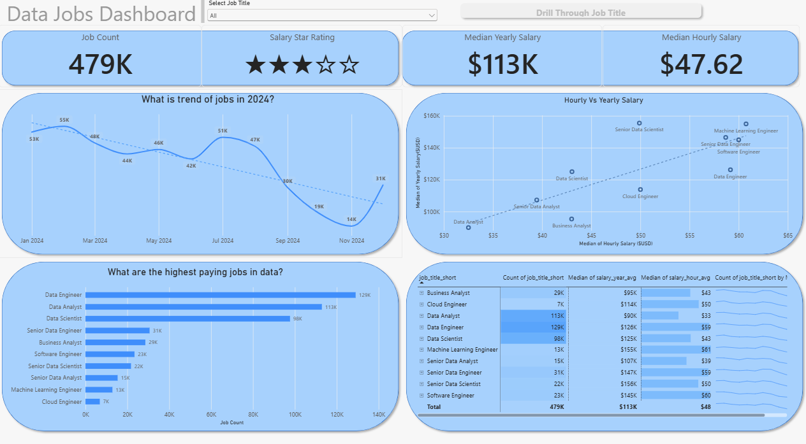

# 📊 My Power BI Dashboard Portfolio 📊

Welcome, Data Enthusiasts! This repository showcases a collection of Power BI dashboards I've created throughout my learning journey. It highlights my progress in Power BI, from basic reporting to advanced interactive data analysis, with a focus on transforming raw data into meaningful insights and actionable decisions.

# Featured Dashboards

Take a look at the dashboards featured below. Each project includes a separate README file with detailed information about its development process, key functionalities, and features.

## 📊 Data Jobs Dashboard (V1 - In-Depth Analysis)

**Key Power BI Skills Applied:**
* 🎨 Dashboard Design & Visual Formatting
* 🛠️ Power Query (Data Extraction, Transformation & Cleaning)
* 🔗 Data Modeling & Table Relationships
* 🧮 DAX Measures & Built-in Aggregations
* 📊 Essential Visualizations (Bar, Line, Area & Column Charts)
* 🌍 Geographical Data Mapping & Visualization
* 🔢 KPI Cards & Interactive Data Tables
* 🎚️ Slicers for Dynamic Data Filtering
* ⚪ Buttons & Bookmarks for Seamless Page Navigation
* ➡️ Drill-Through for Detailed Data Exploration

➡️ **[Explore Full Project 1 Details (README)](./Data_Jobs_v1/README.md)**